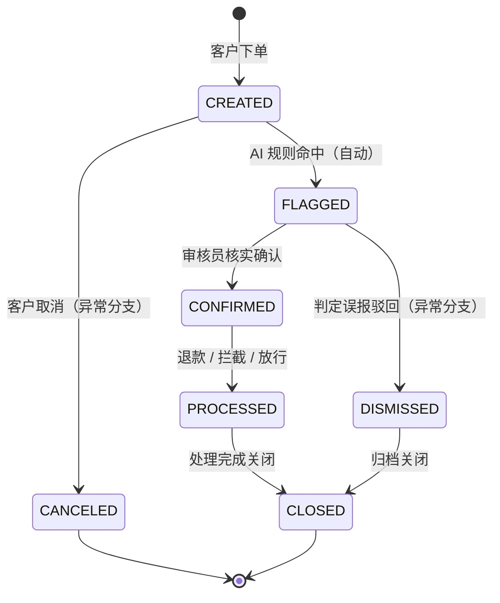

# T47 AI 订单异常识别助手（后端）

> 《JavaWeb 后端开发技术》期末考查项目 · 三人小组协作 · 与《Docker 云容器与管理技术》《MVVM 前端框架开发技术》共用选题

## 一、项目概述

电商平台订单量增长后，异常订单（大额刷单、异常地址、高频下单等）依靠人工逐单排查，成本高且容易漏判。本系统实现「AI 标注 → 人工核实 → 处理 → 关闭」的异常订单闭环管理：

1. 订单创建后，由本地规则引擎（模拟 AI）对订单自动打分，命中规则即标注为异常订单；
2. 审核员在待核实列表中查看异常原因，确认异常或判定为误报；
3. 确认异常的订单进入处理环节（退款 / 拦截 / 放行），处理完成后关闭；
4. 系统统计异常订单数、误报率与规则命中分布，用于评估识别效果。

本项目为课程考查项目，**全部数据均为模拟数据**，不含真实个人信息、真实密码或密钥。

## 二、角色与业务范围

### 2.1 角色权限

| 角色 | 编码 | 权限范围 |
|---|---|---|
| 管理员 | `ADMIN` | 用户与角色管理；全部业务操作 |
| 审核员 | `AUDITOR` | 待核实列表、异常核实、处理、关闭、统计查看 |
| 下单客户 | `CUSTOMER` | 创建订单，查询、取消自己的订单 |

权限在接口层通过 `@RequireRole` 注解 + JWT 拦截器统一校验；数据层通过"当前用户 ID 与订单归属比对"防止水平越权。

### 2.2 状态流转



- 主流程：`CREATED → FLAGGED → CONFIRMED → PROCESSED → CLOSED`
- 异常分支一：`FLAGGED → DISMISSED`（误报驳回，计入误报率）
- 异常分支二：`CREATED → CANCELED`（客户取消）
- 非法流转（如 `CLOSED → CONFIRMED`、`CANCELED → FLAGGED`）由状态机统一拒绝，并返回明确错误码；
- 每次状态变更写入 `order_status_log`（原状态、新状态、操作人、角色、备注、时间）。

## 三、技术栈

| 层次 | 技术选型 |
|---|---|
| 开发语言 | Java 21 |
| 应用框架 | Spring Boot 3.2.x |
| 构建工具 | Maven 3.9+ |
| 持久层 | MyBatis-Plus 3.5.7、MySQL 8 |
| 认证授权 | JWT（jjwt 0.12.5）、BCrypt（spring-security-crypto）、自定义拦截器 |
| 参数校验 | spring-boot-starter-validation（`@Valid`） |
| 接口文档 | Knife4j（OpenAPI 3） |
| 日志 | SLF4J + Logback |
| 容器化 | Dockerfile（由《Docker 云容器与管理技术》课程要求） |
| 前端 | Vue 3 + Vite + Element Plus（最小可用版本） |

## 四、系统架构

### 4.1 分层设计

```
请求 → JWT 拦截器 → Controller → Service → Mapper → MySQL
                                      ↑
                              业务规则、事务、状态机
```

| 层 | 职责 | 禁止事项 |
|---|---|---|
| Controller | 接收参数、`@Valid` 校验、调用 Service、包装 `Result` | 不写业务逻辑，不直接操作 Mapper |
| Service | 业务规则、状态流转、权限判断、事务控制 | 不处理 HTTP、不拼响应结构 |
| Mapper | 数据库读写（MyBatis-Plus BaseMapper + 自定义 SQL） | 不写业务判断 |
| Entity / DTO / VO | Entity 对应表；DTO 接收入参；VO 返回出参 | 不把 Entity 直接返回前端 |

### 4.2 关键设计

- **统一响应**：所有接口返回 `{code, message, data, timestamp}`，前端只判断 `code`；
- **全局异常**：业务异常（`BizException`）与系统异常分开处理，HTTP 状态码与语义一致（400 参数错误、401 未登录、403 越权、404 不存在、409 冲突、500 系统异常）；
- **认证**：登录签发 JWT，拦截器校验签名与过期时间，白名单仅放行登录、注册、健康检查；
- **密码**：BCrypt 加盐哈希存储，数据库中不保存明文；
- **事务**：状态流转涉及"订单表 + 核实记录 + 状态日志"多表写入时使用 `@Transactional`，任一写入失败整体回滚；
- **并发与重复提交**：唯一索引（订单号、单订单仅一次核实）+ 条件更新（`WHERE status = 预期状态`）+ 乐观锁（`version` 字段）三层防护；
- **查询**：列表使用多条件分页（动态 SQL），详情使用多表关联查询返回 VO，避免循环内逐条查询（N+1）。

## 五、目录结构

```
T47-order-anomaly/
├── backend/                        后端工程
│   ├── pom.xml                     Maven 依赖与构建配置
│   ├── Dockerfile                  容器镜像构建文件
│   └── src/main/
│       ├── java/com/t47/anomaly/
│       │   ├── T47Application.java     启动类
│       │   ├── auth/                    JWT 工具、拦截器、当前用户上下文、角色注解
│       │   ├── common/                  统一响应、错误码、业务异常、全局异常处理、分页结果
│       │   ├── config/                  拦截器注册、MyBatis-Plus 插件、密码编码器
│       │   ├── controller/              接口层
│       │   ├── service/ + impl/         业务层
│       │   ├── mapper/                  持久层
│       │   ├── entity/                  数据库实体
│       │   ├── dto/                     入参对象（含校验注解）
│       │   ├── vo/                      出参对象
│       │   ├── enums/                   状态、角色、规则、处理动作枚举
│       │   └── engine/                  AI 异常识别规则引擎
│       └── resources/
│           └── application.yml          数据源、JWT、日志配置（支持环境变量覆盖）
├── database/
│   ├── schema.sql                  建库建表脚本（空库可直接执行）
│   └── seed.sql                    初始化数据（全部为模拟数据）
├── docs/                           需求、数据库设计、接口文档、测试集合、业务流程记录等
├── frontend/                       前端工程（Vue 3 + Element Plus）
├── build.cmd                       构建脚本（锁定 JDK 21 后调用 Maven）
└── README.md                       本文件
```

## 六、数据库设计

### 6.1 数据表清单

| # | 表名 | 说明 | 关键索引 / 约束 |
|---|---|---|---|
| 1 | `sys_role` | 角色表 | `uk_role_code(code)` |
| 2 | `sys_user` | 用户表（密码 BCrypt） | `uk_user_username(username)`、`idx_user_role(role_id)` |
| 3 | `biz_order` | 订单表（业务单据） | `uk_order_no(order_no)`、`idx_order_status_created(status, created_at)`、`idx_order_customer(customer_id)` |
| 4 | `ai_anomaly_result` | AI 异常标注结果（可解释） | `uk_anomaly_order_rule(order_id, rule_code)`、`idx_anomaly_rule(rule_code)` |
| 5 | `order_verify_record` | 人工核实记录 | `uk_verify_order(order_id)`（保证一单只核实一次）、`idx_verify_auditor(auditor_id)` |
| 6 | `order_handle_record` | 处理记录（退款/拦截/放行） | `idx_handle_order(order_id)`、`idx_handle_handler(handler_id)` |
| 7 | `order_status_log` | 状态变更日志 | `idx_status_log_order(order_id)`、`idx_status_log_time(created_at)` |
| 8 | `sys_operation_log` | 系统操作日志 | `idx_op_user(user_id)`、`idx_op_time(created_at)` |

### 6.2 初始化数据

`schema.sql` 与 `seed.sql` 可在空库中依次执行成功；用户、订单、标注、核实、处理、日志等主要表均预置不少于 10 条模拟数据，覆盖全部状态与异常分支。

## 七、接口设计

### 7.1 规范

- RESTful 风格，资源名使用复数名词；
- 认证：`Authorization: Bearer <token>`；
- 统一响应：`{ "code": 0, "message": "成功", "data": ..., "timestamp": 1690000000000 }`；
- 接口文档：服务启动后访问 `/doc.html`（Knife4j）。

### 7.2 错误码

| 业务码 | HTTP | 含义 |
|---|---|---|
| 0 | 200 | 成功 |
| 400 | 400 | 参数校验失败 |
| 401 | 401 | 未登录或 Token 过期 |
| 403 | 403 | 无权限访问 |
| 404 | 404 | 资源不存在 |
| 409 | 409 | 数据冲突 / 重复提交 |
| 1000/1001/1002 | 400/409 | 业务规则不满足（含非法状态流转、重复提交） |
| 500 | 500 | 系统异常 |

### 7.3 接口模块

| 模块 | 接口数 | 说明 |
|---|---|---|
| 认证与健康检查 | 4 | 注册、登录、当前用户、健康检查 |
| 用户与角色管理 | 5 | 用户分页、启用/禁用、调整角色、角色列表 |
| 订单 | 8 | 创建、条件分页、详情、修改、删除、我的订单、取消、状态日志 |
| AI 标注 | 4 | 单笔扫描、批量扫描、异常明细、待核实列表 |
| 人工核实 | 3 | 核实（确认/误报）、核实记录、我的核实历史 |
| 处理与关闭 | 3 | 处理（退款/拦截/放行）、处理记录、关闭订单 |
| 统计 | 4 | 概览、按天趋势、按规则分布、按审核员统计 |

合计 31 个接口，覆盖登录、基础数据管理、业务单据创建与查询、状态流转、异常处理与统计。

## 八、环境与运行

### 8.1 环境要求

| 项目 | 版本 |
|---|---|
| JDK | 21 |
| Maven | 3.9+ |
| MySQL | 8.x |
| Node.js | 18+（仅前端需要） |

### 8.2 环境变量

| 变量 | 说明 | 本地默认值 |
|---|---|---|
| `DB_URL` | 数据库连接串 | `jdbc:mysql://localhost:3306/t47_anomaly?...` |
| `DB_USERNAME` | 数据库账号 | `root` |
| `DB_PASSWORD` | 数据库密码 | 见本地配置，**不写入仓库** |
| `JWT_SECRET` | JWT 签名密钥（≥32 字节） | 本地开发占位值，部署时必须替换 |
| `JWT_EXPIRE_MINUTES` | Token 有效期（分钟） | `120` |
| `SERVER_PORT` | 服务端口 | `8080` |

数据库地址、账号、密码、JWT 密钥均通过环境变量注入，未硬编码在代码中。

### 8.3 初始化数据库

```bash
mysql -u root -p < database/schema.sql
mysql -u root -p t47_anomaly < database/seed.sql
```

### 8.4 构建与启动

```bash
cd backend
mvn clean package
java -jar target/t47-order-anomaly.jar
```

也可使用项目根目录的 `build.cmd`（Windows 环境，自动使用 JDK 21 后调用 Maven）。

### 8.5 运行验证

| 地址 | 说明 |
|---|---|
| `http://localhost:8080/api/health` | 健康检查接口，供容器探针使用 |
| `http://localhost:8080/doc.html` | Knife4j 接口文档 |

## 九、演示账号

以下账号仅用于本地课程演示，数据均为模拟数据。

| 账号 | 密码 | 角色 |
|---|---|---|
| `admin` | `123456` | 管理员 |
| `auditor01` | `123456` | 审核员 |
| `customer01` | `123456` | 下单客户 |

## 十、安全与合规

- 全部数据为模拟数据，不含真实个人信息；
- 密码使用 BCrypt 加盐存储，接口与日志均不输出密码、Token；
- JWT 密钥、数据库密码通过环境变量注入，`.env` 与本地配置文件已加入 `.gitignore`；
- 越权防护：客户仅能访问本人订单，服务端以 Token 中的用户 ID 为准；
- 日志只记录关键操作与异常摘要，不记录敏感字段。

## 十一、提交物

| 内容 | 位置 |
|---|---|
| 源码 | `backend/`、`frontend/` |
| 数据库脚本 | `database/schema.sql`、`database/seed.sql` |
| 需求说明、数据库设计、接口文档、接口测试集合、业务流程记录、贡献表、AI 使用说明 | `docs/` |
| 课程设计报告 | 按课程模板提交 |
| 演示 PPT、演示视频 | 随课程提交物一并提交 |
| 冻结版本 | Git tag `v1.0.0-final` |

## 十二、开发与提交规范

- 分支：`main`（稳定）、`develop`（集成）、`feature/模块名`（功能开发）；
- 提交信息：`feat(模块): 说明`、`fix(模块): 说明`、`docs: 说明`；
- 每位成员独立提交所负责模块，合并前通过 Pull Request 评审；
- 提交冻结：`git tag -a v1.0.0-final -m "期末提交冻结"`，答辩时不得替换。
